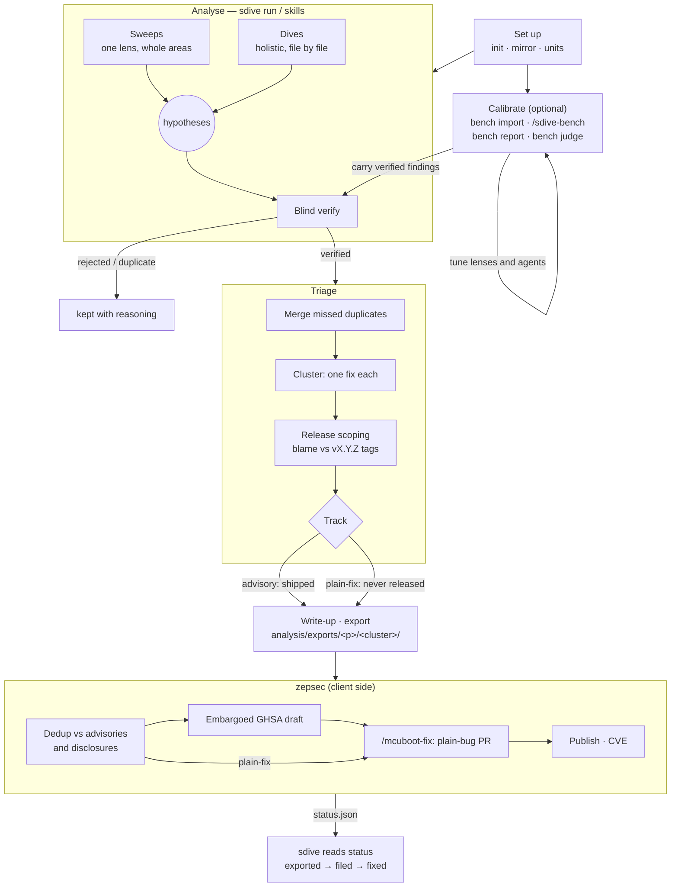

# The security-dive process

How a project goes from source code to fixed, disclosed vulnerabilities, and
which `sdive` command or skill does each step. `PLAN.md` is the design and the
reasons behind it; this file is the operating manual. Steps marked
**(to build)** are agreed but not implemented yet.

All commands are run as `uv run sdive …` from the repo root. Add
`--ledger <name>` (before the subcommand) to work in a disposable ledger such
as a benchmark round; the default is `main`.

## tl;dr

```
# 1. Set up (once per project, then mirror again for new commits and tags)
sdive init
sdive mirror <p>
sdive units <p> [REV]

# 2. Calibrate (optional; blind benchmark at a commit with known answers)
sdive bench import <p> <corpus>... --name <set>
/sdive-bench <p> <set> --rev <commit>
sdive --ledger <round> bench report <p> <set> --rev <commit>
sdive --ledger <round> bench judge <p> <set> <item> <slug>...
sdive carry <p> --from <round>

# 3. Analyse (repeat until the queue is empty)
sdive todo <p>
sdive run <p> [auto|sweep|dive|verify] [LENS] [--minutes M]
    (or interactively: /sdive-sweep, /sdive-dive, /sdive-verify, which use
     sdive next / brief / record / abandon)
sdive coverage <p>
sdive findings <p>

# 4. Triage
sdive finding set <slug> --status duplicate --of <orig>
sdive cluster new <p> <cluster> <slug>... --title T [--rationale R]
sdive scope <p>
sdive cluster track <cluster> advisory|plain-fix --note N
sdive clusters <p>

# 5. Write up and export (to build)
/sdive-writeup <cluster>
sdive export <cluster>

# 6. zepsec, client side (zepsec's skills): dedup, GHSA draft, fix, CVE

# 7. Status back (to build)
sdive sync-status <p>
```

## Flow



---

## 1. Set up

| Command | What it does |
|---|---|
| `sdive init` | Creates `analysis/` (private, its own nested git repo, never published) and `work/` (disposable), and the main ledger `analysis/sdive.db`. |
| `sdive mirror <p>` | Creates or fetches the project's bare mirror in `work/mirrors/`, using the user's checkout only as a `--reference`. Fetches branches and tags. Run it again before analysing new commits or scoping against a new release. |
| `sdive units <p> [REV]` | Exports a read-only snapshot of REV (default: the default branch) to `work/snapshots/<p>/<sha>/` and indexes its files and functions by area (tree-sitter). `sdive snapshot` only exports. |
| `sdive lenses <p>` | Lists lenses and their content hashes. Editing a lens makes a new version, and coverage under the old version no longer counts for it. |

Per-project configuration: `config.toml` (repos, paths, threat model) and
`projects/<p>/project.toml` (scope globs, areas and their priorities,
reference trees, `sweep_order`). Lenses live in `projects/<p>/lenses/`. The
agents' threat model is `projects/<p>/threat-model.md`.

Never write to the user's own source checkouts; everything reads the mirror
and snapshots.

## 2. Calibrate (optional)

A **blind benchmark round** runs the current lenses and agents at a commit
whose vulnerabilities are already known, then scores the result. Use it
before trusting a lens or prompt change on current code.

| Step | What it does |
|---|---|
| `sdive bench import <p> <corpus>... --name <set>` | Imports ground truth from zepsec-style analysis directories into `analysis/truth/<p>/<set>.json`. |
| `/sdive-bench <p> <set> --rev <commit>` | Creates a fresh ledger (`bench-<set>-<date>`), runs sweeps and dives at `<commit>`, verifies every hypothesis, then scores. |
| `sdive --ledger <round> bench report <p> <set> --rev <commit>` | Scores the round: location matches against truth items are only *candidates*. |
| `sdive --ledger <round> bench judge <p> <set> <item> <slug>...` | Records, by human judgement, which findings really raise each truth item (`adjudication.json`). |
| `sdive carry <p> --from <round>` | Copies the round's verified findings into the main ledger as hypotheses at `main`, with locations remapped, so ordinary verification shows which are still live. |

**Blindness.** No analysis agent may see the truth set or zepsec's analysis
trees. A PreToolUse hook (`src/security_dive/blind.py`) refuses `sdive-*`
agents' reads and broad searches of those paths, and `sdive run` hard-denies
them for the whole headless session. Interactive sessions can read them (for
scoring and export), so an interactive orchestrator running analysis keeps to
this by rule. Only `bench report` reads the truth, and only after a round.

## 3. Analyse

Analysis runs as Claude Code skills that dispatch the `sdive-auditor` and
`sdive-verifier` subagents. `sdive` does the bookkeeping and makes no model
calls itself.

**Kinds of run:**

- **Sweep:** one focused lens (memory-safety, authenticity, recovery,
  upgrade-state, rollback, secrets) over a few whole areas per run, covering
  the uncovered in-scope code. Broad and cheap per line.
- **Dive:** the holistic lens over the uncovered functions of the
  highest-priority file. Deep.
- **Verify:** one hypothesis (only the claim and its locations) given to a
  blind verifier that tries to refute it. Verdicts are verified, rejected,
  duplicate or inconclusive (back to hypothesis).

| Command | What it does |
|---|---|
| `sdive todo <p> [--minutes M]` | Work left per kind and lens, with agent-minute estimates from past runs. |
| `sdive run <p> [auto\|sweep\|dive\|verify] [LENS] [--minutes M \| --runs N] [--parallel P]` | Launches a headless Claude session on the matching skill. `auto` runs verify first, then the next lens in `sweep_order` with work left, then dives. Progress streams to the terminal; the log and reported cost go to the ledger's `sessions/`. `-i` opens an interactive session instead; `--dry-run` prints the command. |
| `/sdive-sweep <p> <lens\|all> [N\|all] [--minutes M]` | The sweep skill, run interactively. |
| `/sdive-dive <p> [N\|all] [--minutes M]` | The dive skill. |
| `/sdive-verify <p> [N\|all] [--minutes M]` | The verify skill. |
| `sdive coverage <p>` | Per-area function coverage at the snapshot (current content hashes only: changed code loses its coverage). |
| `sdive findings <p> [--status S]` | Lists findings. `sdive finding show <slug>` gives one, with locations and history, as JSON. |
| `sdive upstream <p>` | Suspected defects noted in external (reference) components. |
| `sdive runs <p>` | Recent runs. |

The skills use the low-level commands, which can also be used by hand:

- `sdive next <p> --kind K --lens L` starts a run, leases its targets for 12
  hours, and prints the brief.
- `sdive brief <run>` reprints the brief.
- The agent writes its result JSON to the ledger's staging directory.
  `sdive schema audit|verify` prints the result schema.
- `sdive record <run>` validates the result and applies it: coverage,
  hypotheses, dossier notes and upstream notes.
- `sdive abandon <run>` releases a started run's targets.

A stopped session is always safe to resume. Runs left `started` are tidied by
the skills: they record the run if a result file exists, and abandon it
otherwise.

Finding lifecycle: `hypothesis → verified | rejected | duplicate → exported →
fixed`. Rejections and duplicates keep their reasoning.

## 4. Triage

Turns verified findings into units of work: one fix PR, and one advisory, per
**cluster**.

| Step | Command |
|---|---|
| **Merge missed duplicates.** The verifier catches most duplicates; the rest are marked by hand, naming the original. The duplicate leaves any cluster. | `sdive finding set <slug> --status duplicate --of <orig> [--note N]` |
| **Cluster.** Group the verified findings that one natural fix closes, with a rationale. Most clusters hold one finding. Zephyr's CNA counting rules want one CVE per independently fixable flaw, so join findings only when one change necessarily fixes them all. | `sdive cluster new <p> <cluster> <slug>... --title T [--rationale R]`, `cluster add` / `remove` (`--move` takes a finding from another cluster) |
| **Release scoping.** Blames each finding's locations at its snapshot (`git blame -w -M -C`) and maps each commit to the first `vX.Y.Z` tag holding it. Verdicts: `released` (every flagged line, as it reads now, was in the latest release), `post-release` (none was), `mixed` (read the post-release commits: they are often changes around the defect, not the defect itself), `unknown` (nothing blamable, e.g. a submodule path). `as_is_since` is an upper bound on when the bug arrived, not the advisory's floor. Run `sdive mirror` first to pick up new tags. | `sdive scope <p> [slug...] [--redo] [--json]` |
| **Track.** A human decision, recorded with its reason, following the disclosure policy in `PLAN.md`: code that shipped in a release → `advisory`; merged since the last release and never shipped → `plain-fix` (an ordinary fix, no GHSA or CVE). | `sdive cluster track <cluster> advisory\|plain-fix --note N` |
| **Review.** | `sdive clusters <p>` (clusters with track, combined scope and release range, then verified findings in no cluster); `sdive cluster show <cluster>` (JSON) |

## 5. Write up and export (to build)

- **Write-up** (`/sdive-writeup <cluster>`, to build): drafts, per cluster,
  what zepsec needs and the ledger lacks:
  - the advisory summary and description
  - the recommended fix
  - the affected configurations (`MCUBOOT_*` / Kconfig)
  - the CVSS vector
  - the introducing commit
- **Export** (`sdive export <cluster>`, to build): writes
  `analysis/exports/<p>/<cluster>/`. The directory holds:
  - `cluster.json`, shaped like zepsec's MCUboot `result.json`:
    `is_vulnerability`, `reportable`, severity and CVSS, CWE,
    `advisory_summary`/`advisory_description`, `affected_components`,
    `affected_versions`, `introduced_by`, `property_violated`,
    `attacker_class`, `recommended_fix`, plus provenance (snapshot, runs,
    verifier verdicts, `carried_from`)
  - a readable `cluster.md`

  The member findings move to `exported`. The export stays on this machine.
  It never goes to zepsec's prod Instance and never contains truth-set
  content.

## 6. zepsec, client side

zepsec's work, not sdive's. A local intake channel on the zepsec client reads
the export directory. It dedups against MCUboot advisories and the disclosure
corpus, then runs the pre-fix flow:

- **`advisory` clusters:** embargoed GHSA draft → `/mcuboot-fix` (a plain-bug
  PR from the user's fork) → merge → publish → CVE (Zephyr is MCUboot's CNA).
- **`plain-fix` clusters:** only the fix.

sdive's blind verification is trusted: zepsec does not re-validate.

Fix commits and PRs use plain bug-fix wording: nothing from `analysis/`, no
security framing while the advisory is embargoed.

## 7. Status back (to build)

zepsec writes `status.json` next to each export (dedup verdict, GHSA id, fix
PR, fix SHA). sdive reads it (`sdive sync-status <p>`, to build) to move the
findings along: `exported` → known (a duplicate of an existing advisory) or
filed → `fixed`. The ledger stays the single place that tracks every
finding's state.

## Change findings (Phase 3, to build)

Unmerged PRs and newly merged commits get their own review flow; see
`PLAN.md`, *Disclosure policy for change findings*. A finding in an unmerged
PR becomes a PR comment, shown to the user before posting.
